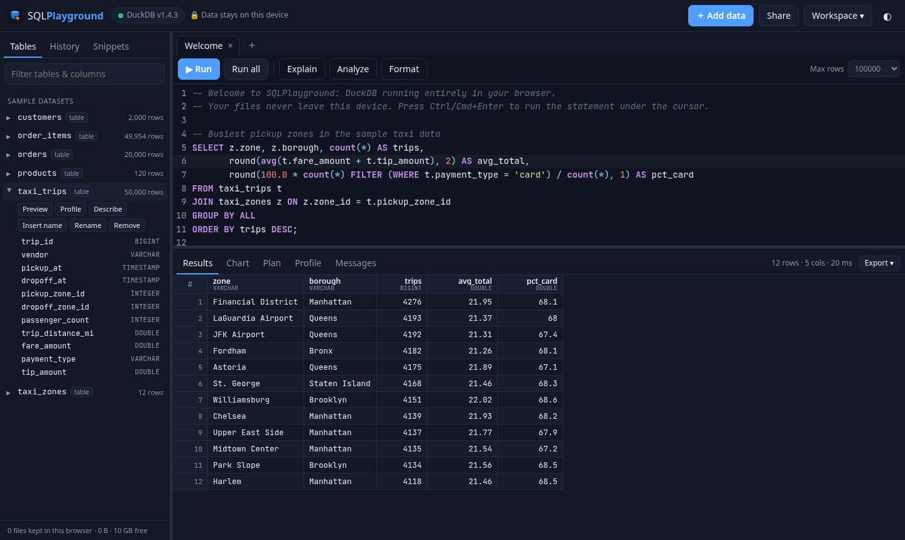
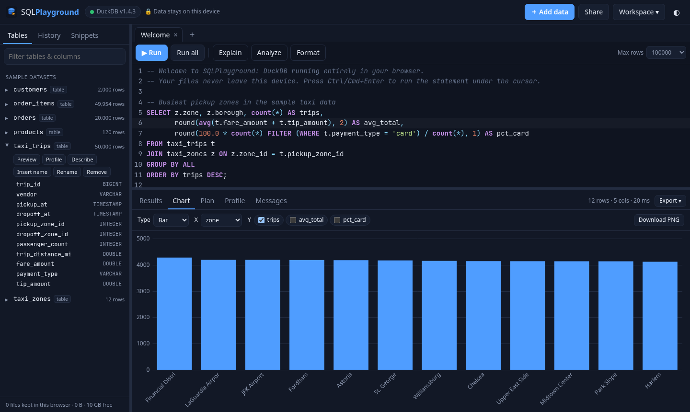

# SQLPlayground

**Drop in CSV, Parquet, JSON or Excel files and query them with real SQL, right in your browser.**
Charts, profiling and exports included. No server, no sign-up, and your files never leave your device.

**Try it: https://shaikbasha1437.github.io/sqlplayground/**



SQLPlayground runs [DuckDB](https://duckdb.org) compiled to WebAssembly (`@duckdb/duckdb-wasm` 1.32.0, DuckDB engine v1.4.3) in a Web Worker.
It is the same analytical engine you would use on a laptop or in a pipeline, so window functions, `QUALIFY`, `PIVOT`, `GROUP BY ALL`, list/struct types, `read_parquet`, `SUMMARIZE` and the rest all work.

## Features

**Data in**
- Drag and drop or pick **CSV, TSV, Parquet, JSON, NDJSON/JSONL and XLSX** files. Pick several at once.
- For each file you can edit the table name and set the format, delimiter and header, turn type detection on or off, and pick the Excel sheet.
- Each file loads either as a **table** (faster queries) or as a **view** (less memory, reads the file each time).
- **Load from a URL.** You can download the file once, or keep a live view over the URL, where DuckDB uses HTTP range reads so only the Parquet bytes it needs are fetched. The server must send CORS headers; the app explains what to do when it doesn't.
- Files are kept in your browser (IndexedDB) and come back after a reload. The sidebar shows how much space they use, and you can remove them one at a time or all together.
- **Sample datasets** are generated by SQL at startup, with no download:
  - an NYC-style taxi set: `taxi_trips` (50k rows) and `taxi_zones`
  - a shop star schema: `orders`, `order_items`, `customers` and `products`

**Editor**
- CodeMirror 6 with DuckDB syntax highlighting. **Autocomplete** covers your tables, their columns (including after an alias, like `p.`), every DuckDB function and keywords.
- **Ctrl/⌘+Enter** runs the statement under the cursor, or the selection. **Ctrl/⌘+Shift+Enter** runs everything.
- Query **tabs**, a **Format** button (sql-formatter's DuckDB dialect), **history** and **snippets**. There are 13 built-in DuckDB recipes, such as dedupe with `QUALIFY`, gap filling, `PIVOT` and sessionisation, and you can save your own.
- When a query fails, the error marks the failing line. **Cancel** stops long queries.

**Schema and profiling**
- The schema sidebar lists tables, views, columns, types and row counts, with one-click actions: Preview, **Profile**, Describe, Rename, Keep and Remove.
- **Profile** shows null %, distinct counts, min/max, mean and quartiles (via `SUMMARIZE`), plus a histogram for every numeric or date column and top values for text columns.

**Results**
- A virtualized grid handles 100k+ rows. You can sort, resize columns (double-click to autofit) and select cells, ranges or rows. Copying gives TSV, so it pastes straight into a spreadsheet; Shift adds the headers.
- The grid shows the row count and query time and reports when the display limit was reached (exports always use the full result).
- **Explain** and **Explain Analyze** show the physical plan with timings.
- **Charts**: bar, line, area, scatter and pie, with automatic suggestions and multiple Y series, and **PNG download**.



**Data out**
- Export results as **CSV**, **CSV for Excel** (UTF-8 BOM), **XLSX**, **Parquet** (zstd), **JSON** or **NDJSON**.
- Copy them as **Markdown**, **TSV** or **`INSERT` statements**, or save them as a new table.
- **Export the whole database** as a zip of Parquet files plus `load.sql`. Running `duckdb my.db < load.sql` rebuilds it locally.
- **Share links** put the query, but never the data, into the URL hash (compressed), so a teammate can open the same SQL against their own files.
- **Workspaces** save your tabs and snippets to a file. Add your saved tables to put the data in a single `.zip` too, then open the file on another machine.

**App**
- Dark and light themes, resizable panes, and a layout that works on phones and tablets.
- Works **offline** after the first visit: the service worker caches the engine and the extensions.
- Installable as a PWA. Everything uses relative paths, so it runs from any static host or sub-folder.

## Privacy

There is no backend. Files are read by DuckDB inside your browser tab, and the only network requests go to this site's own static files, plus any URL you choose to load. Saved tables live in your browser's IndexedDB until you remove them.

## Limits

- Memory is whatever the browser allows a tab, usually around 2–4 GB of WebAssembly memory. Multi-GB Parquet files work best as **views** or URL views, so DuckDB only reads the columns and row groups it needs.
- Loading from a URL needs the server to allow cross-origin reads (CORS). S3 and GCS buckets need a CORS rule, and GitHub `raw` links and Hugging Face dataset files work.
- Bundled extensions: `parquet`, `json`, `excel` and the core functions. Others, such as `spatial` and `icu` time-zone functions, are not bundled.
- `INTERVAL` columns show a hint in the grid. Cast them (`col::VARCHAR`) to see the value.
- Exporting to a native `.duckdb` file isn't offered, because the browser build can't hand back an attached database file reliably. Use the Parquet + `load.sql` export instead.
- It's tested in Chrome and Firefox, on desktop and mobile. Recent Safari should work too. Browsers with WebAssembly exception handling, such as Chrome and Edge, get the faster build.

## Development

It's a static site with no build step for the app code. `vendor/` holds pinned, pre-built copies of the libraries.

```bash
npm install            # dev only: test deps + vendor rebuild
npm test               # unit tests + DuckDB smoke test (Node build of the same engine)
python3 -m http.server # then open http://localhost:8000
npm run build:vendor   # rebuild vendor/lib.js and copy the DuckDB bundles (see vendor/VERSIONS.txt)
```

The extensions in `ext/v1.4.3/` come from `extensions.duckdb.org` for this exact engine version. They are loaded through `custom_extension_repository`, so the app never needs a CDN.

| Path | What |
| --- | --- |
| `index.html`, `styles.css` | UI |
| `app.js` | the app: import, run, schema, export, share, workspaces |
| `db.js` | DuckDB engine wrapper (worker, streaming, cancel, COPY exports) plus IndexedDB storage |
| `editor.js` | CodeMirror setup: dialect, autocomplete, error marks |
| `grid.js`, `chart.js` | virtualized result grid, canvas charts |
| `core.js` | pure helpers: statement splitting, CSV/Markdown/INSERT, share links, zip, formatting (unit-tested) |
| `samples.js` | sample datasets, welcome query, snippets |
| `sw.js` | network-first service worker for offline use |

## License

MIT © 2026 shaikbasha1437. DuckDB and duckdb-wasm are MIT-licensed, as are CodeMirror (MIT), Apache Arrow (Apache-2.0) and sql-formatter (MIT).
